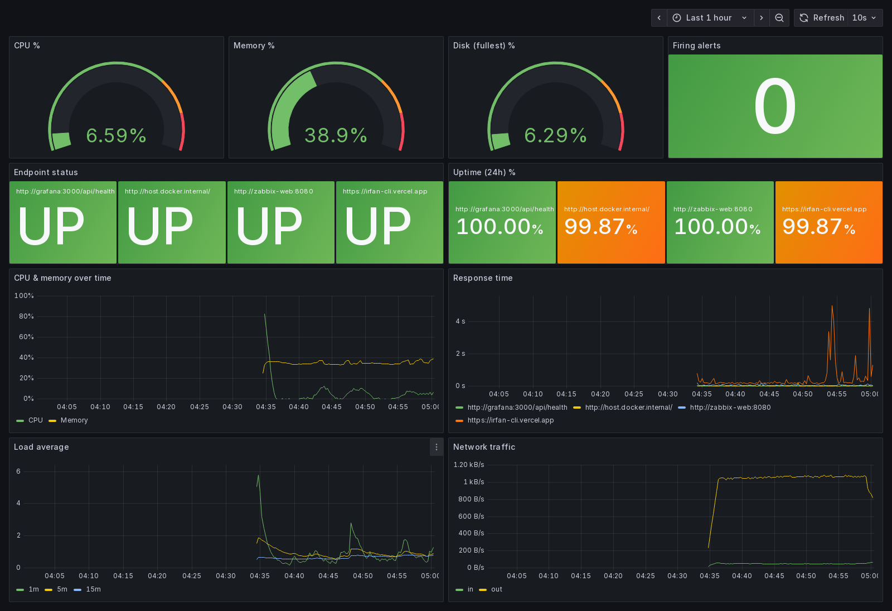
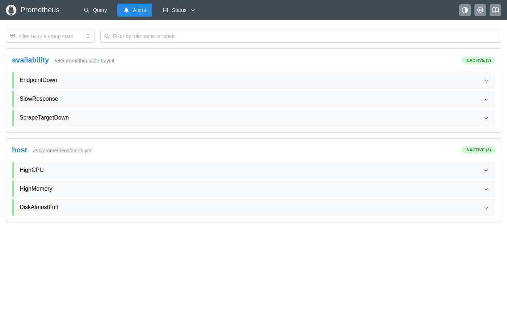
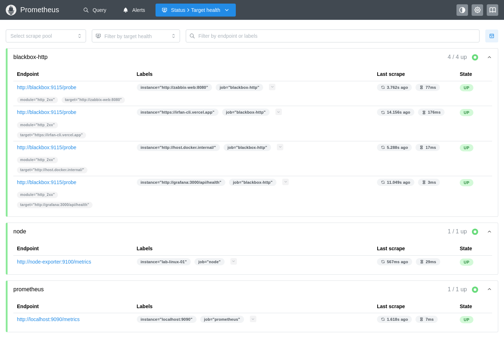

# Monitoring Lab: Prometheus, Grafana, Alertmanager, Zabbix

A local NOC/SOC-style monitoring stack in Docker Compose. It watches a Linux host and HTTP endpoints, alerts on CPU, memory, disk and availability, and shows the same host in both Prometheus/Grafana and Zabbix.

It's the lab companion to **[fleet-monitoring](https://github.com/Irfan-Ahamed-Seyam/fleet-monitoring)**, a production Zabbix + Grafana rollout across 6 servers. This lab covers what's unsafe to try on production: Prometheus, alert rules, and deliberately breaking things to watch alerts fire and recover.


<sub>A custom Grafana dashboard: host CPU, memory and disk gauges, firing-alert count, endpoint UP/DOWN status and 24h uptime from blackbox probes, response times, load and network.</sub>

## What's in it
| Component | Role | URL |
|---|---|---|
| Prometheus | Pull-based metrics collection + alert rules | http://localhost:9090 |
| node-exporter | Linux host metrics (CPU, RAM, disk, network) | scraped by Prometheus |
| blackbox-exporter | HTTP uptime and latency checks (SLA-style) | scraped by Prometheus |
| Alertmanager | Groups and routes alerts | http://localhost:9093 |
| Grafana | Dashboards (Prometheus + Zabbix data sources) | http://localhost:3000 (admin/admin, lab default) |
| Zabbix 7.0 LTS | Agent-based monitoring with triggers, PostgreSQL backend | http://localhost:8080 (Admin/zabbix) |
| zabbix-agent2 | Monitored host `lab-linux-01` | |

> Credentials in this repo are local lab defaults. Change them before exposing anything beyond localhost.

## Run
```bash
docker compose up -d
docker compose ps
```

### Requirements
Docker with Compose v2, about 2 GB free RAM. Tested on Docker Desktop with the WSL2 backend (Windows 11) and Ubuntu 24.04.

### Troubleshooting
| Symptom | Fix |
|---|---|
| node-exporter: `path / is mounted on / but it is not a shared mount` | Docker Desktop doesn't support `rslave`. Mount the root as `/:/host:ro` (already done here) |
| No disk metrics; node-exporter logs `was collected before with the same name` | Duplicate Docker Desktop/WSL bind mounts. Exclude them with `--collector.filesystem.mount-points-exclude` (already done here) |
| DiskAlmostFull fires on `/usr/lib/wsl/drivers` | That's the Windows C: drive over 9p. Excluded in the alert rules |
| Grafana blackbox probe for itself shows DOWN right after start | Grafana is still installing plugins. It turns UP in about a minute |

## Alerts (prometheus/alerts.yml)
- HighCPU: > 80% for 1m
- HighMemory: > 90% for 2m
- DiskAlmostFull: > 85% for 5m
- EndpointDown: blackbox probe failing for 1m
- SlowResponse: response time > 2s
- ScrapeTargetDown: Prometheus can't reach an exporter

## Screenshots

| Alert rules (Prometheus) | Scrape targets: 6/6 up |
|---|---|
|  |  |

## Incident drills
1. **CPU spike:** `docker run --rm -it --cpus=8 alpine sh -c "apk add -q stress-ng && stress-ng --cpu 8 --timeout 180s"` → HighCPU fires in Prometheus/Alertmanager, and the Zabbix "High CPU utilization" trigger fires.
2. **Service down:** `docker compose stop zabbix-web` → EndpointDown fires within ~1 minute; `docker compose start zabbix-web` → it resolves.
3. **Exporter down:** `docker compose stop node-exporter` → ScrapeTargetDown fires.

## Useful PromQL
```promql
100 - avg by (instance)(rate(node_cpu_seconds_total{mode="idle"}[2m])) * 100   # CPU %
(1 - node_memory_MemAvailable_bytes / node_memory_MemTotal_bytes) * 100        # RAM %
probe_success                                                                  # endpoint up (1) / down (0)
probe_duration_seconds                                                         # response time
```

## Drill results (2026-11-10)
**Drill 1: CPU spike.** I ran stress-ng on 8 cores for 4 minutes.
- Prometheus HighCPU went pending, then fired at 99%. Alertmanager received it.
- Zabbix's default trigger ("min over 5m > 90%") did not fire, because the spike was shorter than 5 minutes. I added a custom trigger, `min(/lab-linux-01/system.cpu.util,1m)>80`, and it fired.
- Both alerts resolved on their own when the load stopped.

**Drill 2: Website outage, recovered by GitOps.** I ran `kubectl scale deploy/my-web-app --replicas=0` on the k3d cluster.
- At +5s the site returned HTTP 503, and at +7s the blackbox probe showed it down.
- At +13s Argo CD (selfHeal) had restored 2/2 pods and the site was back to HTTP 200. At +22s the probe confirmed it was up.
- EndpointDown went no further than pending, because the outage (~15s) was shorter than the 1-minute alert threshold. That's intended: short blips don't page anyone.

**Tuning: false positive.** DiskAlmostFull fired on `/usr/lib/wsl/drivers`, which is the Windows C: drive mounted into WSL over 9p at 89%. It isn't part of the monitored Linux host, so I excluded `9p|squashfs|nsfs` filesystems from the disk rule and the dashboard.

**Fix: no disk data under Docker Desktop on WSL (2026-11-12).** node-exporter rejected *all* filesystem metrics because Docker Desktop exposes duplicate internal bind mounts ("collected metric ... was collected before with the same name and label values"). I excluded those mount points and the pseudo filesystems (`tmpfs`, `9p`) in node-exporter's flags. Disk usage is reported again.

**Cleanup:** I disabled the default "Zabbix server" host. It expects an agent on 127.0.0.1 inside the server container, which doesn't exist in this setup.
